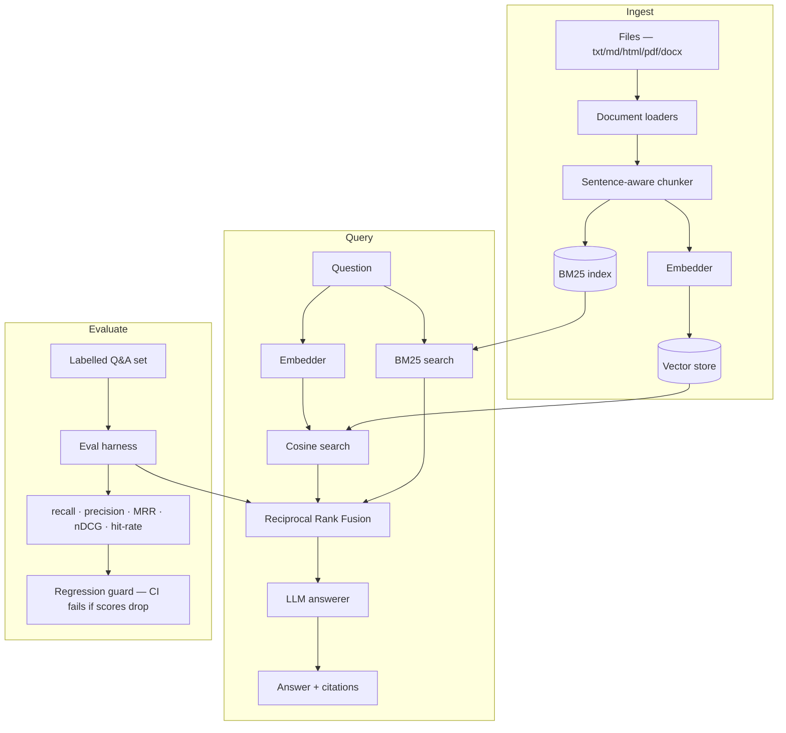

# 🔦 Lumen RAG

> A small, **transparent, and *evaluated*** Retrieval-Augmented Generation engine. Ingest documents, retrieve with vector search, answer with citations — and **measure retrieval quality** with a proper IR metric suite.

[](https://github.com/WickTech/lumen-rag/actions/workflows/ci.yml)


Most RAG demos stop at "it answered my question." Lumen treats retrieval as the
engineering problem it actually is: it ships an **evaluation harness** so you can
prove that recall@5 went *up* when you change your chunking, embeddings, or
reranking — instead of vibes.

> 🔌 **Runs 100% offline.** With no API key, Lumen uses a deterministic hashing
> embedder and an extractive answerer, so the full pipeline — including the eval
> suite — runs in CI with zero secrets. Add `OPENAI_API_KEY` for real embeddings
> and generated answers.

---

## ✅ Current Status

| | |
|---|---|
| **Tests** | 41/41 passing — chunker, vector store, BM25, RRF, loaders, IR metrics, end-to-end |
| **CI** | GitHub Actions: lint (ruff) → pytest → eval regression guard on every push |
| **Python** | 3.10 and 3.12 tested |
| **Offline** | Full pipeline runs with zero API keys or network access |
| **Deployment** | `Dockerfile` ready; FastAPI server on port 8000; [hosted demo on HF Spaces](https://huggingface.co/spaces/WickTech/lumen-rag) |

---

## 🎮 Live demo

**[Try it hosted on Hugging Face Spaces →](https://huggingface.co/spaces/WickTech/lumen-rag)**

Upload your own `.txt`/`.md`/`.html`/`.pdf`/`.docx` files (or load the bundled
sample corpus), ask questions against them, and watch retrieval quality
(recall@k, MRR, nDCG@k) render live from the eval harness — no signup, no API
key, runs entirely on the offline hashing embedder.

Run it locally instead:

```bash
lumen serve && open http://localhost:8000
```

---

## ✨ Features

- **Sentence-aware chunking** with configurable size + overlap.
- **Exact cosine vector search** in a tiny, persistable store (swap for pgvector/Qdrant without touching callers).
- **BM25 + Reciprocal Rank Fusion** — true sparse/dense hybrid retrieval; choose `vector`, `bm25`, or `hybrid` mode per query.
- **Cited answers** — every response carries numbered source citations.
- **Streaming answers** — Server-Sent Events on `POST /query/stream`.
- **Multi-format ingestion** — `.txt`, `.md`, `.html`/`.htm` (no extra deps), `.pdf` (`pip install lumen-rag[pdf]`), `.docx` (`pip install lumen-rag[docx]`).
- **Interactive demo UI** — upload docs, ask questions, and watch eval metrics render live at `/` (served by the FastAPI app, no separate frontend build).
- **Cross-encoder reranking** — optional second stage (`LUMEN_RERANKER=BAAI/bge-reranker-base`, `pip install lumen-rag[rerank]`): any mode over-fetches `k × LUMEN_RERANK_POOL` candidates and a BGE cross-encoder (ONNX via fastembed, no torch) picks the final top-k. On the bundled eval set at k=3: MRR 0.974 → 1.000, nDCG 0.968 → 0.980.
- **Layout-aware parsing** — optional Docling backend (`LUMEN_DOCLING=1`, `pip install lumen-rag[docling]`) for PDF/DOCX/PPTX/HTML: reading order, multi-column pages, and tables exported as Markdown.
- **📊 Evaluation harness** — recall@k, precision@k, MRR, nDCG@k, hit-rate over a labelled question set.
- **Claim-level diagnostics** — `lumen eval-answers --claims` labels every answer claim supported / distractor / unsupported and attributes wrong answers to retrieval or generation, offline.
- **Answer-quality eval** — `lumen eval-answers data/eval.jsonl` judges generated answers with [DeepEval](https://github.com/confident-ai/deepeval) (faithfulness, answer relevancy, contextual relevancy; plus contextual precision/recall for cases with an `expected_answer`). Needs `OPENAI_API_KEY` and `pip install lumen-rag[answer-eval]`.
- **Eval regression guard** — `scripts/check_eval.py` enforces minimum score thresholds in CI; the build fails if retrieval quality drops.
- **Three interfaces** — Python API, Typer CLI, and a FastAPI server.

---

## 🏗️ Architecture



```
lumen_rag/
├── ingestion/
│   ├── loaders.py   txt / md / html / pdf / docx → {"id","text","metadata"}
│   ├── chunker.py   sentence-aware chunking with overlap
│   └── pipeline.py  docs → chunks → embeddings → vector store
├── store.py         persistable cosine vector store (.lumen_index/)
├── retrieval/
│   ├── bm25.py      BM25Index + reciprocal_rank_fusion()
│   └── retriever.py Retriever(mode=vector|bm25|hybrid)
├── embeddings.py    HashingEmbedder (offline) + OpenAIEmbedder
├── llm.py           grounded answerer with citations; offline extractive fallback
├── eval/            ⭐ IR metrics + evaluation harness
├── api/             FastAPI — /ingest /ingest/upload /query /query/stream /eval /health /stats
│   └── static/      interactive demo UI, served at /
├── cli.py           lumen ingest | ask | eval | serve
└── scripts/
    └── check_eval.py  eval regression guard (enforces score thresholds)
```

---

## 🚀 Quick start

```bash
git clone https://github.com/WickTech/lumen-rag && cd lumen-rag
pip install -e ".[dev]"            # add ,openai for real embeddings

# Index the sample corpus and ask a question (works offline)
lumen ingest data/docs                                 # picks up .txt, .md, .html, .pdf, .docx
lumen ask "How many approvals does a billing change need?"
lumen ask "When do we deploy?" --mode bm25             # vector | bm25 | hybrid

# Measure retrieval quality and enforce score thresholds
python scripts/check_eval.py data/eval.jsonl --k 3 --mode hybrid
```

Example eval output:

```
  Retrieval eval — 19 cases @ k=3
  ----------------------------------
  recall@k       0.9737
  precision@k    0.3333
  mrr            0.9737
  ndcg@k         0.9677
  hit_rate       1.0000
```

### As a server

```bash
lumen serve            # or: docker build -t lumen . && docker run -p 8000:8000 lumen
curl localhost:8000/health
curl -X POST localhost:8000/ingest -H 'content-type: application/json' \
  -d '{"documents":[{"id":"d1","text":"We deploy at 4pm on weekdays."}]}'
curl -X POST localhost:8000/query  -H 'content-type: application/json' \
  -d '{"question":"When do we deploy?","k":3,"mode":"hybrid"}'
```

Interactive docs at `http://localhost:8000/docs`.

### As a library

```python
from lumen_rag.engine import RagEngine

engine = RagEngine()
engine.add_documents([{"id": "policy", "text": "Engineers get 20 vacation days."}])
print(engine.query("How much vacation do I get?").text)
```

---

## 🧪 Testing

```bash
pytest -q                                                   # 41 tests, all offline
ruff check .                                                # lint
python scripts/check_eval.py data/eval.jsonl --k 3          # eval regression guard
```

CI runs on Python 3.10 & 3.12: lint → pytest → `check_eval.py` (enforces recall@k ≥ 0.80, hit\_rate ≥ 0.80, mrr ≥ 0.70). The build fails if scores drop.

---

## 📊 Benchmarks — what chunking and retrieval mode actually buy you

Measured with `scripts/benchmark.py`, offline hashing embedder, no reranker, k=5.
Two eval sets ship with the repo:

- **v1** — `data/docs` (7 files) + `data/eval.jsonl` (19 questions). A fast smoke
  test, but **saturated**: k=5 returns 5 of the 7 documents, so recall is ~1.0
  for any configuration and tells you nothing.
- **v2** — `data/eval_v2` (120 short docs, 176 questions in five categories:
  direct, paraphrase, disambiguation, multihop, unanswerable). Built so that
  configurations can be told apart; see [`data/eval_v2/README.md`](data/eval_v2/README.md).

Reproduce with `python scripts/benchmark.py` (v1) or `python scripts/benchmark.py --set v2`.

### v2 (discriminating)

| Configuration | recall@5 | precision@5 | MRR | nDCG@5 | hit rate |
|---|---|---|---|---|---|
| vector-only | 0.74 | 0.17 | 0.69 | 0.69 | 0.78 |
| BM25 only | **0.90** | 0.21 | **0.88** | **0.87** | **0.94** |
| hybrid (BM25 + RRF) | 0.82 | 0.19 | 0.73 | 0.74 | 0.86 |

MRR by question category (153 answerable questions; the 23 unanswerable ones are counted, not scored):

| Configuration | direct | disambiguation | multihop | paraphrase |
|---|---|---|---|---|
| vector-only | 0.84 | 0.77 | 0.67 | 0.54 |
| BM25 only | 0.98 | 0.89 | 0.86 | 0.80 |
| hybrid (BM25 + RRF) | 0.84 | 0.78 | 0.76 | 0.59 |

Paraphrased and multi-hop questions are the hard cases for the offline embedder.
Hybrid lands between its two inputs here: the hashing embedder is a weak,
bag-of-words dense signal, so fusing it with BM25 pulls the ranking *down* from
BM25 alone. That is a property of this offline embedder, not of hybrid retrieval
in general; re-run with `OPENAI_API_KEY` set to see how a real embedder changes it.

### v1 (smoke test)

| Configuration | recall@5 | precision@5 | MRR | nDCG@5 | hit rate |
|---|---|---|---|---|---|
| naive (1 chunk/doc, vector-only) | 1.00 | 0.21 | 0.96 | 0.98 | 1.00 |
| + sentence chunking (vector-only) | 0.97 | 0.20 | **1.00** | 0.98 | 1.00 |
| BM25 only (sentence chunking) | 0.97 | 0.20 | 0.96 | 0.96 | 1.00 |
| hybrid (BM25 + RRF, sentence chunking) | 0.97 | 0.20 | 0.97 | 0.97 | 1.00 |

> **Correction (2026-10-18):** earlier versions of this table (and
> [`docs/case-study.md`](docs/case-study.md)) reported naive MRR 0.93 and "+ hybrid"
> equal to chunked-vector. `evaluate()` did not apply the retrieval mode, so every
> row had in fact been measured in hybrid mode and the "vector-only" labels were
> wrong. `evaluate()` now takes `mode=`, and the numbers above are the real ones.

## 🔬 Claim-level diagnostics — where do wrong answers come from?

Retrieval metrics say whether the right *documents* came back; answer judges say whether an
answer *reads* well. Neither says why an answer is wrong. `lumen eval-answers --claims`
splits every answer into claims, aligns each claim with the retrieved chunks, and attributes
failures to the retriever or the generator. It needs no API key and no judge model.

```bash
lumen ingest data/eval_v2/docs
lumen eval-answers data/eval_v2/eval.jsonl --claims --mode bm25 --out per_case.json
```

Per **claim**: `supported` (grounded in a retrieved chunk from a gold document), `distractor`
(grounded in retrieved *non-gold* text: faithful, but the wrong evidence) or `unsupported`
(not grounded in anything retrieved). Per **answerable question**: `ok`, `retrieval-miss`
(answer wrong and a gold document was not retrieved) or `generation-error` (answer wrong
although every gold document was retrieved). Per **unanswerable question**: `abstained` or
`hallucinated`.

Results on the [v2 set](data/eval_v2/README.md), offline extractive answerer, k=5:

| Retrieval mode | answer ok | retrieval-miss | generation-error | claim precision | faithfulness |
|---|---|---|---|---|---|
| vector-only | 0.73 | 0.23 | 0.05 | 0.33 | 1.00 |
| BM25 only | **0.88** | 0.09 | 0.03 | 0.45 | 1.00 |
| hybrid (BM25 + RRF) | 0.78 | 0.16 | 0.06 | 0.37 | 1.00 |

Reading it:

- **Most wrong answers are retrieval failures.** Under vector-only search 23% of questions fail
  because the gold document was not retrieved, against 5% where it was retrieved but the answer
  still missed it. Better retrieval (BM25) is what lifts answer accuracy from 0.73 to 0.88.
- **A `generation-error` here means the answerer ignored evidence it had.** The offline answerer
  pastes only the top 2 chunks, so a gold document retrieved at rank 3 to 5 still produces a wrong
  answer.
- **`unsupported` is 0 and faithfulness is 1.00 by construction**: an extractive answerer only
  repeats retrieved text. These claim rates become informative with a generative answerer
  (`OPENAI_API_KEY`), where fabricated claims can appear.
- **Claim precision is mostly answer noise**: the share of answer sentences that come from the gold
  document rather than from the other retrieved chunks it was stitched together with.
- **The offline answerer never declines**, so 0 of 23 unanswerable questions are `abstained`. An
  abstain-below-a-score rule is an obvious next step, and this report will measure it.

Alignment is a deterministic lexical overlap (share of a claim's content words found in a chunk,
default threshold `--tau 0.6`). It cannot see paraphrase or negation, so with a generative
answerer treat the rates as an approximation. `diagnose_claims(..., aligner=fn)` accepts any
`(claim, chunk_text) -> score` function, so an NLI model or an LLM judge can replace it.

---

## 🗺️ Roadmap

- [x] **BM25 hybrid search** — sparse + dense fusion via Reciprocal Rank Fusion; `vector | bm25 | hybrid` mode per query
- [x] **PDF / DOCX / HTML ingestion** — document loaders with clean text extraction
- [x] **Streaming answers** — server-sent events on `POST /query/stream`
- [x] **Eval regression guard** — `scripts/check_eval.py` in CI; build fails if recall drops
- [ ] **pgvector / Qdrant / Pinecone adapters** — swap the in-memory store for a production vector DB without touching engine callers
- [x] **Cross-encoder reranker** — second-stage BGE reranking via fastembed (`LUMEN_RERANKER`)
- [x] **Layout-aware ingestion** — Docling backend for PDF/DOCX/PPTX/HTML (`LUMEN_DOCLING=1`)
- [x] **Answer-quality eval** — DeepEval faithfulness / relevancy metrics (`lumen eval-answers`)
- [x] **Claim-level diagnostics** — `lumen eval-answers --claims` attributes wrong answers to retrieval vs generation, offline
- [ ] **Multi-tenant namespaces** — isolate document collections per user/team with a namespace key
- [ ] **Async FastAPI endpoints** — connection-pooled async DB and embedder calls for concurrency
- [ ] **Fine-tuned embedding adapter** — LoRA adapter trained on domain Q&A pairs to improve recall

---

## 📈 What this demonstrates

- Treating retrieval quality as a **measurable, regression-tested** property.
- Clean ports-and-adapters design: embedder, store, reranker, and answerer are each swappable.
- Pragmatic offline-first engineering so the project is reproducible without secrets.
- Shipping the same core through three surfaces (library / CLI / HTTP).

## 📄 License

MIT — see [LICENSE](./LICENSE).
